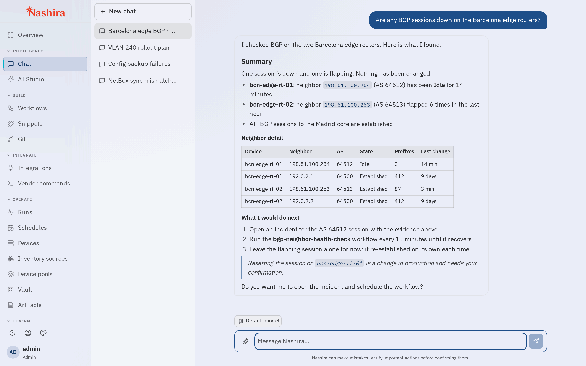
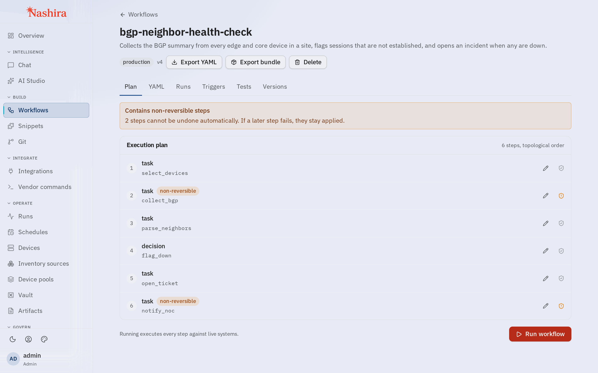
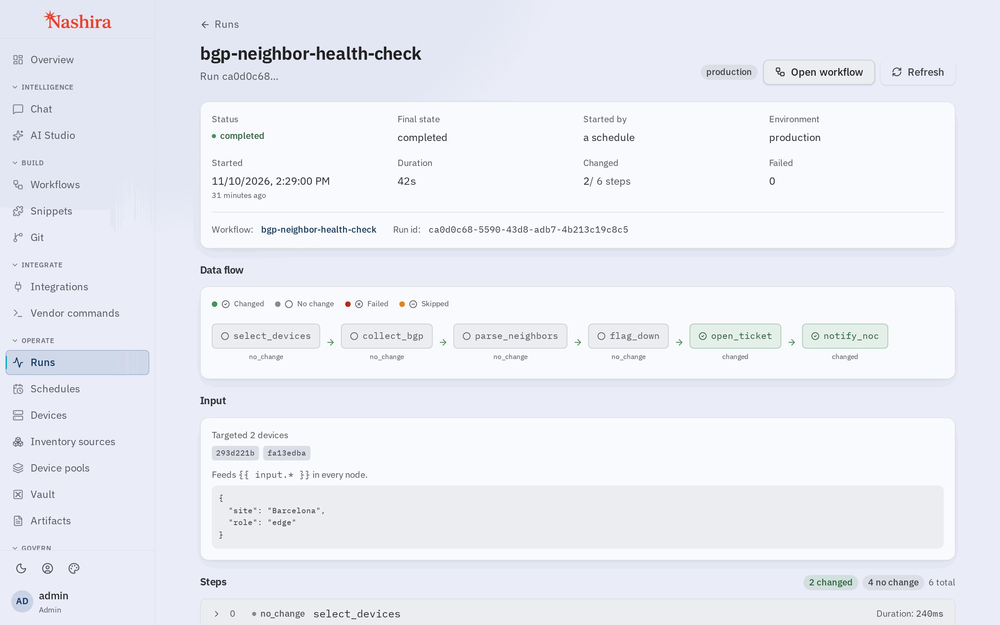
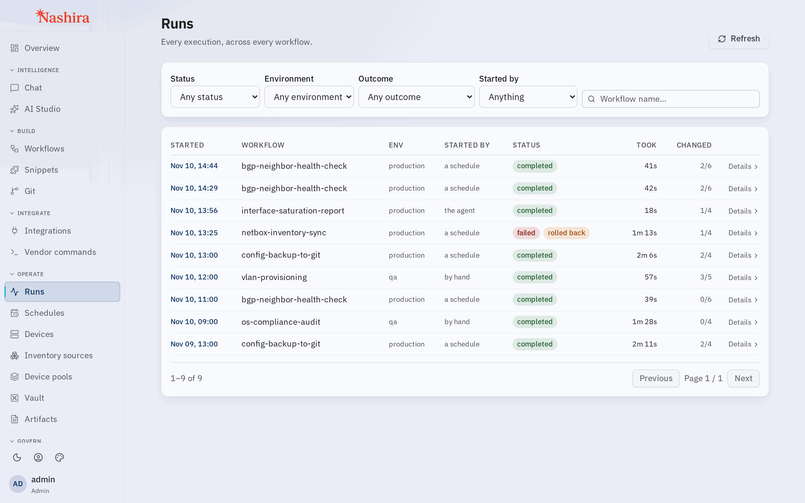
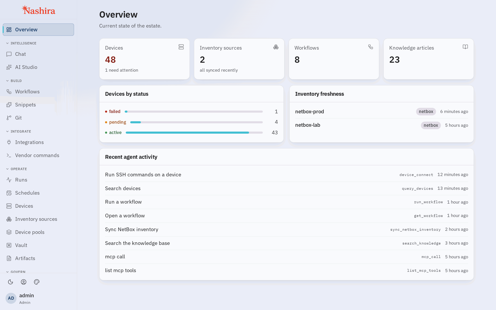

# Nashira

Nashira is a self-managed conversational operations platform. It gives operators one interface to understand systems, coordinate actions and run governed workflows across connected tools.

The AI layer interprets requests and helps assemble operations. Execution is performed by platform services and deterministic, code-based workflows under configured permissions, policies and confirmations. Once a workflow has been created, its normal execution does not require an LLM and does not consume model tokens.

Network operations are Nashira's most extensively validated domain today. The platform model is broader: integrations, API specifications, skills and MCP servers extend the systems that Nashira can operate.

## What it looks like

<picture><source media="(prefers-color-scheme: dark)" srcset="docs/images/chat-dark.png"></picture>

Ask in plain language. The agent reads the connected systems, reports what it found and proposes next steps; changes follow the configured permissions, policies and confirmations.

| | |
| --- | --- |
| <picture><source media="(prefers-color-scheme: dark)" srcset="docs/images/workflow-dark.png"></picture> | <picture><source media="(prefers-color-scheme: dark)" srcset="docs/images/run-dark.png"></picture> |
| **Workflow plan.** Each step in order, with the steps that cannot be rolled back automatically marked. | **Run detail.** Status, data flow between steps, inputs and per-step results. |
| <picture><source media="(prefers-color-scheme: dark)" srcset="docs/images/runs-dark.png"></picture> | <picture><source media="(prefers-color-scheme: dark)" srcset="docs/images/overview-dark.png"></picture> |
| **Runs.** Every execution, what started it, and how it ended. | **Overview.** Devices by status, inventory freshness and recent agent activity. |

The screenshots use invented data.

## Start here

- [Quick start](QUICK_START.md)
- [Documentation map](docs/README.md)
- [Security policy](SECURITY.md)
- [Support](SUPPORT.md)
- [Contribution guide](CONTRIBUTING.md)
- [Governance](GOVERNANCE.md)

## Operating principles

- **Governed execution:** roles, permissions, risk classification and policy determine what can run and when confirmation is required.
- **Deterministic workflows:** promoted workflows execute as code-backed artifacts rather than as repeated model conversations.
- **Auditability:** important operations produce structured traces that can be reviewed independently of the model response.
- **Provider choice:** deployments can use supported commercial providers or locally managed inference, according to configuration.
- **Portable integrations:** skills, specifications and workflow bundles make operational knowledge reusable.

## Project status

Nashira is under active development. Do not infer a production support commitment or compatibility window from an unreleased branch. Published releases and their support status must be identified in release notes.

## License

Nashira is licensed under the [Apache License 2.0](LICENSE). The same license applies to three explicitly identified scopes: platform code, workflows, and the skills/specifications ecosystem. See [Licensing](docs/legal/LICENSING.md) and the license notice closest to the relevant content.

Nashira and its visual identity are unregistered trademarks of Isaza Labs LLC. See [Trademark policy](docs/legal/TRADEMARKS.md). Do not use the registered trademark symbol.
